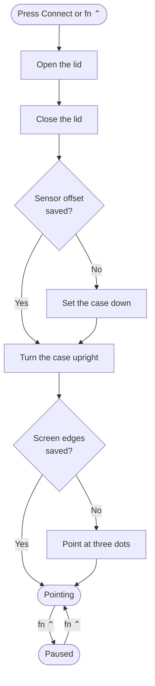
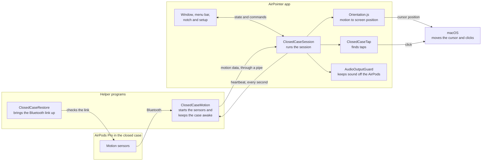

# AirPointer

AirPointer turns AirPods Pro in their closed case into a pointer for your Mac.
Move the case to move the cursor. Tap the front of the case to click.

All processing happens on your Mac. The app has no network code.

## Before you use it

AirPointer is an early build. Apple did not make it and does not support it. It
uses private Apple protocols, so a macOS or AirPods update can stop it working.

- **Case analytics:** Ending a session uses up the diagnostic analytics stored on
  the case.
- **AirPods settings:** Some AirPods connection settings stay as the session set
  them. We do not know yet if this effect, or the analytics effect, continues
  after the link resets.
- **Audio:** Each connection drops the AirPods' Bluetooth link for a moment.
  Audio through the AirPods stops. Do not connect during a call.
- **Microphone:** During a session, the app keeps Mac sound and the microphone off
  all AirPods. The app restores them when the session ends.
- **Cursor size:** A cursor smaller than 2× grows to 2× while you point. It returns
  to its size when you pause or disconnect. After a force quit, it returns when
  you next open the app. This uses a private macOS call.

## Requirements

| Item | Status |
|---|---|
| AirPods Pro 3, macOS 26, Apple Silicon | Tested on one Mac with one pair |
| AirPods Pro 2 | Recognized, not tested |
| macOS 14 and 15 | Allowed, not tested |
| Xcode | Required to build |

Normal connect and disconnect have run many times on that Mac and pair. These
cases have not been tested on purpose:

- Force quit during a session
- Sleep and wake during a session
- Bluetooth lost during a session
- Calls and audio during and after a session

## Build and run

```sh
zsh ./build.sh
open AirPointer.app
```

The build also runs the offline checks. Do not build during a pointer session.

If AirPointer does not appear in the Accessibility list after a rebuild, run:

```sh
tccutil reset Accessibility local.airpointer
```

## How to use it

The first time you open the app, setup has four steps:

1. **Allow:** Drag AirPointer into the Accessibility list. This lets it move the
   cursor and click.
2. **Connect:** Open the lid, close the lid, set the case down for a moment, and
   turn it upright.
3. **Calibrate:** Point at three dots to show the app where your screen is.
4. **Tap:** Tap the front of the case three times.

After that, press **fn ⌃** in any app to connect. Press it again to pause or
resume. To use a different shortcut, go to Settings.



## How it works



1. **Connect:** `ClosedCaseRestore` makes sure the AirPods' ordinary Bluetooth link
   is up. `ClosedCaseMotion` then reconnects them once, because the motion channel
   only answers just after a connection.
2. **Stream:** `ClosedCaseMotion` starts the sensors and sends paced requests to
   keep the closed case awake. It sends the motion data to the app.
3. **Keep alive:** The app sends a heartbeat every second. If the app stops, the
   helper stops the sensors and releases what it holds.
4. **Point:** `Orientation.js` calculates the case's orientation and converts it to
   a screen position.
5. **Click:** `ClosedCaseTap` looks for a sudden movement in the direction of a tap.
   If it finds one, the app clicks and plays a short sound on the Mac.

If motion stops for less than two seconds, the pointer stops and then continues.
If motion stops for longer, the pointer pauses and continues when motion returns.
A session ends 30 minutes after the lid closes. To continue, open and close the lid.

## Code map

| File | Purpose |
|---|---|
| `ClosedCase/CaseSustainedRenewal.m` | Builds `ClosedCaseMotion.bin`, the helper that talks to the AirPods. Lists its exit codes at the top. |
| `ClosedCaseRestore.swift` | Brings the ordinary Bluetooth link up. |
| `ClosedCaseAirPods.swift` | Finds the paired AirPods. |
| `ClosedCaseSession.swift` | Runs a session, reads motion data, and moves the cursor. |
| `ClosedCase/Orientation.js`, `MotionLearning.swift` | Motion math. |
| `ClosedCaseTap.swift` | Finds taps and learns their direction. |
| `AudioOutputGuard.swift` | Keeps sound and the microphone off the AirPods during a session. |
| `CursorSize.swift` | Grows a small cursor while you point. |
| `PointerShortcut.swift` | The shortcut and its control in Settings. |
| `AirPointer.swift`, `AppHome.swift` | Start the app and connect the session to its windows. |
| `AirPointerHome.swift`, `StatusBarUI.swift`, `NotchFlow.swift` | The window and Settings, the menu bar, and the notch. |
| `SetupAssistant.swift`, `AccessibilityGuide.swift`, `CaseLessons.swift` | Setup, the panel over System Settings, and calibration. |
| `RemoteKit.swift` | Shared interface components. |
| `TapTest.swift` | The Tap Test, for developers. |
| `Checks.swift`, `HomeChecks.swift`, `ClosedCase/TapFixtures.csv` | Offline checks and their test data. |
| `Assets/` | Images, sounds and the 3D case model. See [Assets/README.md](Assets/README.md). |
| `render-closed-case.py`, `seat-earbuds.py` | Make the onboarding case images from the 3D model. These need Blender. The app uses the finished images. |

[DESIGN-SYSTEM.md](DESIGN-SYSTEM.md) has the rules for the interface.

## Data on your Mac

The app keeps its data in `~/Library/Application Support/AirPointer/`.

| File | Contents |
|---|---|
| `closed-case-target.txt` | The AirPods to use |
| `closed-case-grip.json` | Saved screen edges |
| `closed-case-sensor-calibration.json` | Saved sensor offset, kept for one week |
| `PointerSessions/` | Logs from the newest ten sessions |
| `TapTests.jsonl` | Tap Test scores |

The app does not send any of this anywhere.

In a session's `native.log`:

- `STEP` lines show the time of each connection step.
- `HOLD` lines show the motion rate and delay, about once a second.
- `tap` lines explain each tap.
- The `EXIT` line shows why the session ended.

## Troubleshooting

| Problem | What to do |
|---|---|
| The app does not connect | Turn off Bluetooth on your iPhone. Your iPhone can hold the AirPods. |
| "Connecting" does not end | Open the lid and keep it open until the app tells you to close it. |
| The pointer lags or motion stops | Make sure no other app, such as OBS or a browser call, uses the AirPods as a microphone. |
| The pointer stutters just after you connect | This is normal for about 20 seconds. |
| "Set it down" takes a long time | Use a firm, flat surface and do not touch the case. |
| Taps do not click | Go to Settings > Teach Tap. Do this again if you change how you hold the case. |

## Tap Test

Taps are tuned on one person so far, so your score may differ.

Connect, then go to **File > Developer > Tap Test**. The test takes about 75
seconds and tells you when to tap.

To also save a session's raw motion, run this before you connect. A session
records up to about 20 MB.

```sh
defaults write local.airpointer recordMotion -bool true
```

## Offline checks

These checks do not use Bluetooth.

```sh
AirPointer.app/Contents/MacOS/AirPointer --check-home
AirPointer.app/Contents/MacOS/AirPointer --check-pointer-settings
AirPointer.app/Contents/MacOS/AirPointer --check-closed-case-native
AirPointer.app/Contents/MacOS/AirPointer --check-audio-output-policy
AirPointer.app/Contents/MacOS/AirPointer --check-closed-case-tap ClosedCase/TapFixtures.csv
AirPointer.app/Contents/Resources/ClosedCaseMotion.bin --self-test
```

## Uninstall

Quit AirPointer, delete this folder, then run:

```sh
rm -rf ~/Library/Application\ Support/AirPointer
defaults delete local.airpointer
tccutil reset Accessibility local.airpointer
tccutil reset BluetoothAlways local.airpointer
```
